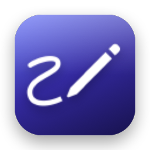
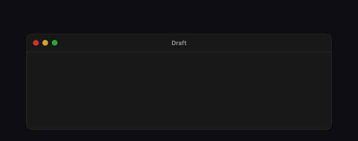
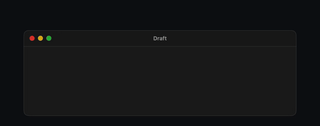
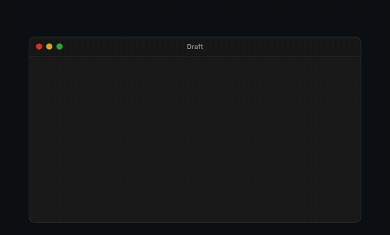
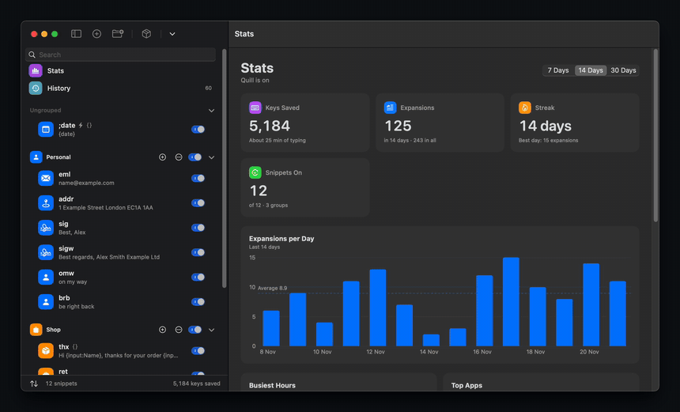
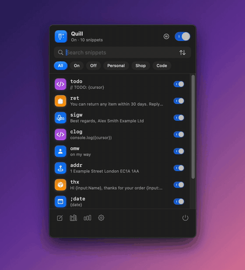
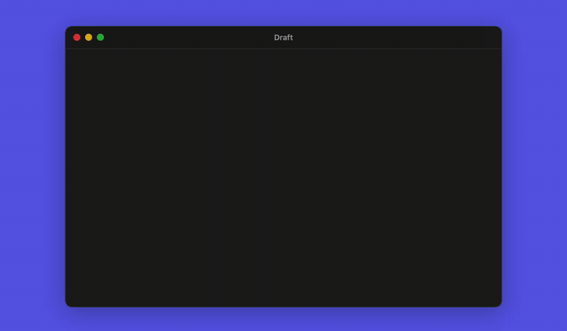
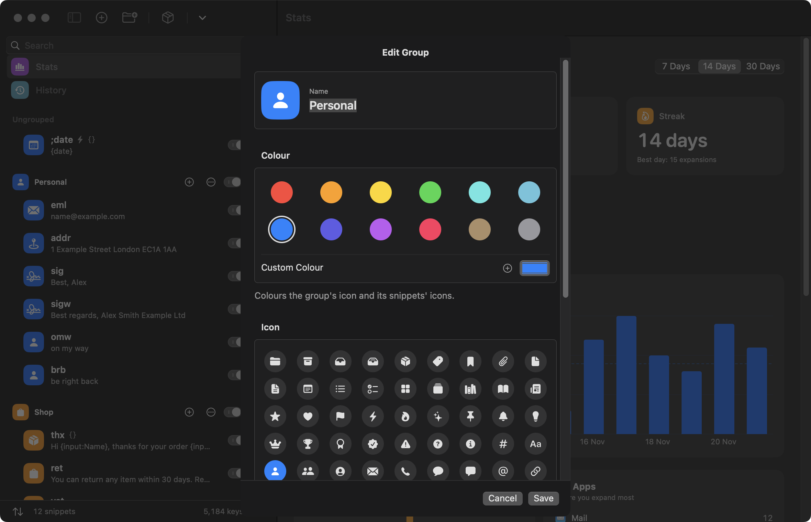
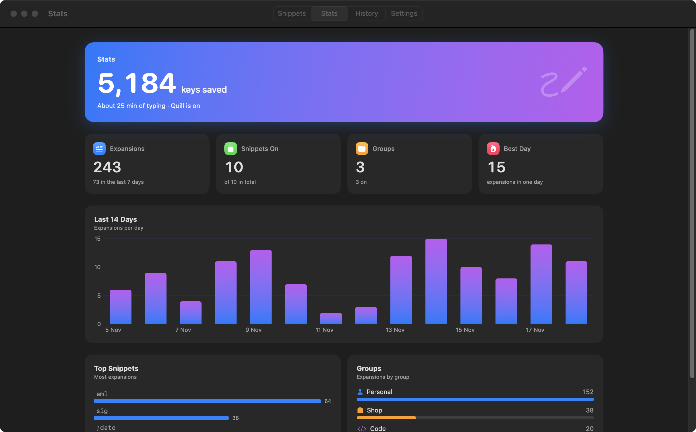
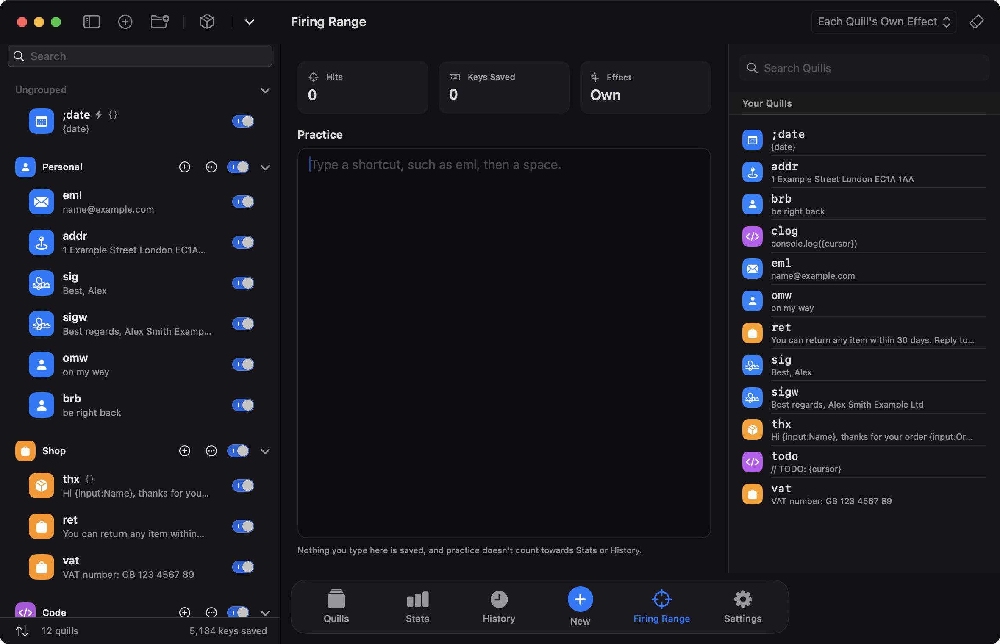

<div align="center">
  
  <h1>Quill</h1>
  <p><b>Type a short shortcut anywhere on your Mac and get the full text.</b></p>

[](https://github.com/ajd1776/Quill-Auto-Text-Replacement/releases/latest)


[](LICENSE)

</div>

<p align="center">
  
</p>

<p align="center"><a href="docs/media/demo.mp4"><b>▶ Watch the 30-second demo</b></a></p>

Quill is a system-wide text expander that lives in the menu bar. Each shortcut is a *quill*: you type `eml` and get `name@example.com`, in any app. It works like macOS Text Replacements, but works in every app, shows a suggestion bubble as you type, supports tokens and fill-in fields, and keeps everything in a local JSON file. Native SwiftUI, no dependencies, no account.

## Download

**[Download the latest version](https://github.com/ajd1776/Quill-Auto-Text-Replacement/releases/latest)**, open the `.dmg` and drag Quill into Applications.

Requires macOS 15 or later (Liquid Glass on macOS 26). Universal build for Apple Silicon and Intel.

> [!NOTE]
> Quill isn't notarised, so macOS blocks the first launch. Open System Settings › Privacy & Security, click **Open Anyway**, then allow Accessibility access when Quill asks. It needs that to see what you type and to type the replacement.

## Features

The most useful first:

- **Expands everywhere.** Type a shortcut in any app (native, browser or Electron) and it becomes the full text. Expands after a space, punctuation or Return, or the moment you finish typing it.
- **Suggestion bubble.** Matching quills appear above your text as you type. Space accepts an exact match, Tab the highlighted one, ↑ ↓ choose, Esc dismisses.
- **Tokens and fill-in fields.** `{date}`, `{date:FORMAT}`, `{time}`, `{clipboard}` and `{cursor}`, plus `{input:Name}`, which asks for a value in a small form before the text goes in.
- **On and off in place.** Every quill and group has its own switch in the sidebar, and Quill itself turns off or pauses from the menu bar (<kbd>⇧</kbd> <kbd>⌘</kbd> <kbd>P</kbd>).
- **Menu bar panel.** Search your quills, filter by group, switch them on and off, or click one to type it where you were typing. A tab bar along the bottom jumps to any page, or quits Quill.
- **Firing Range.** A practice page where your quills fire for real, with a clickable cheat sheet, a hit counter and an effect to try. Practice never counts towards your stats.
- **Groups, icons and colours.** Collapsible groups, 126 SF Symbols or any emoji, the system colours and your own saved colours, set in one sheet.
- **Drag to reorder.** Rearrange quills, move them between groups and reorder groups by dragging.
- **Bring your quills.** Import your macOS Text Replacements, or add a starter pack: emoji shortcodes (`:fire:` → 🔥), typo fixes (`teh` → `the`) and date formats (`;dmy` → `18/11/2026`).
- **Fine control.** Limit a quill to certain apps, pause Quill in an app, match capitals (`EML` → ALL CAPS), keep or drop the space after an expansion, and press Delete straight after one to undo it.
- **Stats and History.** Keys and time saved, your streak, busiest hours, top apps and quills, a Tidy Up list, and a searchable log of recent expansions.
- **13 effects.** Pop Badge, Typewriter, Highlight, Ink Underline, Confetti, Sparkle, Cyber and more, drawn over the text and respecting Reduce Motion.
- **One window.** Your quills stay in the sidebar, and a floating tab bar switches the right-hand side between the editor, Stats, History, the Firing Range and Settings.
- **Keyboard first.** <kbd>⌘</kbd> <kbd>K</kbd> command palette, a global search hotkey, `quill://` links to any page, and Shortcuts app actions (Insert Quill, Get Quill Text, Add Quill, Turn Quill On/Off).
- **Private and local.** One JSON file on your Mac with daily backups and JSON import and export. Password fields are never seen. The only network request is a daily update check against GitHub Releases.

### See it in action

| Suggestion bubble | Fill-in form |
| --- | --- |
|  |  |

<p align="center"></p>

| Menu bar panel | Effects |
| --- | --- |
|  |  |

## Screenshots

| Quills and editor | Icon and Colour |
| --- | --- |
|  |  |

| Stats | Firing Range |
| --- | --- |
|  |  |

| Settings | History |
| --- | --- |
|  |  |

| Command palette | Starter packs |
| --- | --- |
|  |  |

## How to use it

1. Open Quill and allow Accessibility access.
2. Click **New** in the tab bar, type a shortcut such as `eml`, pick a colour and icon, then type the text it should become.
3. Type `eml` followed by a space in any app.

| Shortcut | Action |
| --- | --- |
| <kbd>⌘</kbd> <kbd>N</kbd> | New quill |
| <kbd>⇧</kbd> <kbd>⌘</kbd> <kbd>N</kbd> | New group |
| <kbd>⌘</kbd> <kbd>K</kbd> | Command palette |
| <kbd>⌘</kbd> <kbd>0</kbd> | Stats |
| <kbd>⌘</kbd> <kbd>Y</kbd> | History |
| <kbd>⌘</kbd> <kbd>R</kbd> | Firing Range |
| <kbd>⇧</kbd> <kbd>⌘</kbd> <kbd>P</kbd> | Turn expansion on or off |
| <kbd>⌘</kbd> <kbd>,</kbd> | Settings |

The global on/off and search-panel hotkeys are set in Settings › Shortcuts.

## FAQ

<details>
<summary><b>Why does it need Accessibility access?</b></summary>

To see the shortcut you type (a keyboard event tap), to type the replacement, and to find the cursor so the bubble and effects sit above your text. What you type never leaves your Mac, and macOS never sends password fields to Quill.

</details>

<details>
<summary><b>Where are my quills stored?</b></summary>

In `~/Library/Application Support/Quill/snippets.json`, with daily backups next to it. Settings › Backup can export and import it, and show the backups in Finder.

</details>

<details>
<summary><b>The bubble or effect appears in the wrong place in one app.</b></summary>

Quill asks the app where the cursor is. Some apps don't say; there the bubble is skipped rather than drawn in the wrong place. Expansion itself still works.

</details>

<details>
<summary><b>I rebuilt from source and expansion stopped working.</b></summary>

An ad-hoc signed build counts as a new app to macOS, so allow Accessibility access again. Signing with your own team (below) keeps the permission across rebuilds.

</details>

## Building from source

```bash
git clone https://github.com/ajd1776/Quill-Auto-Text-Replacement.git
```

```bash
cd Quill-Auto-Text-Replacement && Tools/install.sh
```

Builds a Release, copies it to `/Applications` and opens it. Needs Xcode 26. No Apple account is needed; without a Team ID the build is signed ad hoc. To keep the Accessibility grant across rebuilds, sign with your free Apple Development team:

```bash
echo 'DEVELOPMENT_TEAM = YOUR_TEAM_ID' > Config/Signing.xcconfig
```

<details>
<summary><b>Development notes</b></summary>

```bash
xcodebuild -project Quill.xcodeproj -scheme Quill -configuration Debug \
  -derivedDataPath build.noindex CODE_SIGN_IDENTITY=- build
```

```bash
xcodebuild test -project Quill.xcodeproj -scheme Quill -destination 'platform=macOS' -derivedDataPath build.noindex
```

Runs the unit tests (`QuillTests`: tokens, case matching, store, moves and ordering, colours, stats, history filters, pages and links, the engine self-test) and the UI tests (`QuillUITests`: the tab bar, switches, collapsing, drag to reorder, Icon and Colour, the editor, search, Settings, the Firing Range and the welcome tour). The UI tests drive the mouse and keyboard for about two minutes. Both use the in-memory demo library, never your real quills, and Debug builds use their own bundle ID (`dev.quill.Quill.debug`), so testing doesn't touch the installed app's settings.

Debug-only launch arguments:

- `-QuillSelfTest`: engine and model self-test.
- `-QuillDemoData`: in-memory sample library, never saved.
- `-QuillDemo <view>`: opens `library`, `stats`, `history`, `range`, `editor`, `appearance`, `newsnippet`, `panel`, `palette`, `welcome` (with `-QuillWelcomeStep 0`–`3`), a settings pane, `bubble`, `fillin`, or plays an effect by name.
- `-QuillDemo stage:<scene>`: plays a scripted scene for the README recordings: `hero`, `bubble`, `fillin`, `effects`, `panel` or `tour`. It prints the screen area to record.
- `-QuillUpdateCheck`: one live update check, then quits. `-QuillFakeUpdate` simulates an available update.

How it works:

- A session `CGEventTap` watches key-downs, keeps a short buffer and matches shortcuts at word boundaries.
- Replacement sends synthetic backspaces, then Unicode key events (paste with clipboard restore above 160 characters). Quill tags its own events and ignores them.
- The cursor position comes from the Accessibility API (`AXBoundsForRange`, or `AXBoundsForTextMarkerRange` for Chromium and Electron), queried off the main thread.

| Path | Contents |
| --- | --- |
| `Quill/App` | Entry point, app state, commands, menu bar icons, App Intents |
| `Quill/Engine` | Event tap, matching, key emitter |
| `Quill/Suggestions` | Suggestion bubble, fill-in form |
| `Quill/Overlays` | Cursor locator, effect overlays |
| `Quill/Model` | Quills (`Snippet` in code), groups, store, token renderer, stats |
| `Quill/Views` | Pages, tab bar, editor, Firing Range, menu bar panel, settings |
| `Quill/Search` | Floating search panel |
| `Quill/Hotkeys` | Global hotkeys and recorder |
| `Quill/Import` | macOS Text Replacements reader |
| `Quill/Debug` | Self-test, demo data, scripted demo scenes |
| `QuillTests` | Unit tests |
| `QuillUITests` | UI tests |
| `Config` | `Base.xcconfig`, Info.plist additions |
| `Tools` | Install script, icon generators |

</details>

## Contributing

Bug reports and pull requests are welcome.

## Licence

MIT, see [LICENSE](LICENSE).
