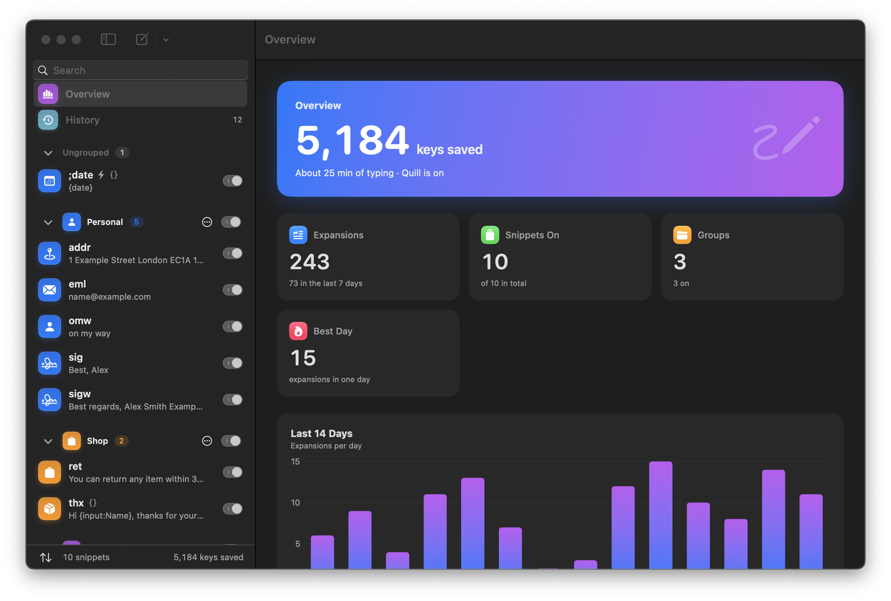
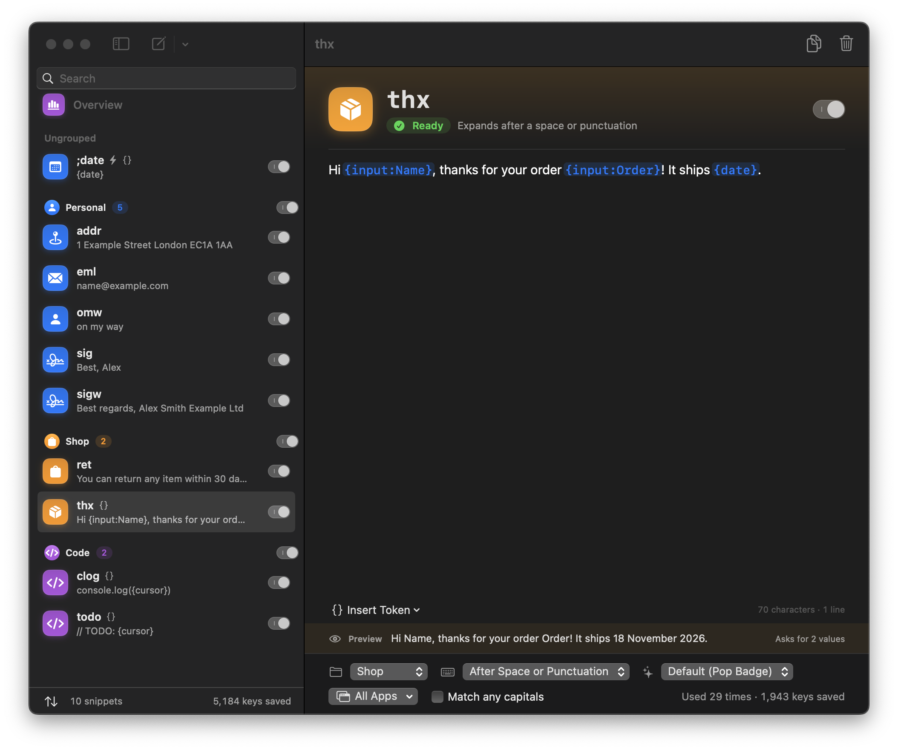
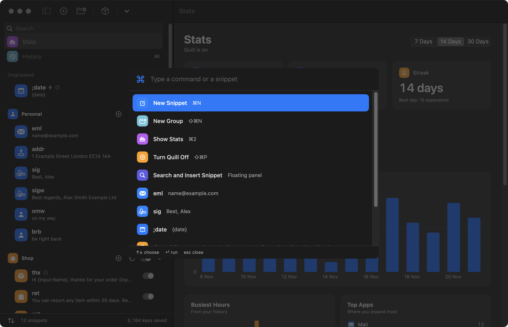
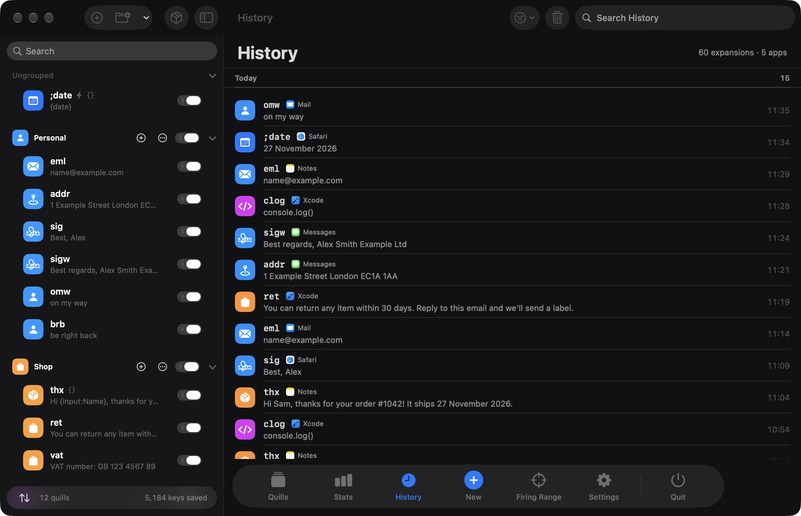
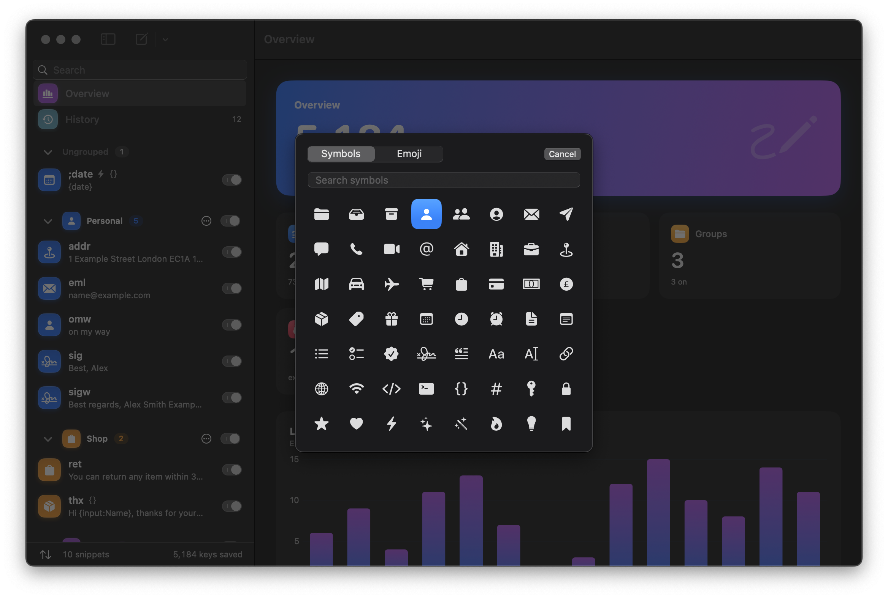
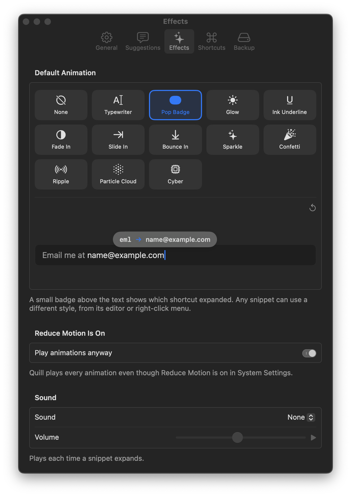
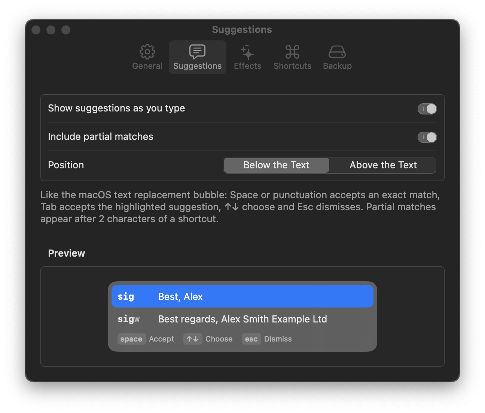

# Quill – Auto Text Replacement

System-wide text expander for macOS. Type a shortcut, get the full text. Native SwiftUI menu bar app, no dependencies.



## Features

- **Expansion**: case-sensitive, whole-word shortcuts. Fires after space/punctuation/Return, or immediately. Delete right after undoes.
- **Suggestion bubble**: shown at the cursor while typing, like the macOS replacement bubble. Space accepts an exact match, Tab accepts the highlighted one, ↑↓ select, Esc dismisses. Partial matches after 2 characters.
- **Tokens**: `{date}`, `{date:FORMAT}`, `{time}`, `{clipboard}`, `{cursor}`, `{input:Label}`. Fill-in fields open a form before inserting.
- **Per-snippet options**: groups, icon, expansion mode, animation, app allow-list, case matching (`EAD` → ALL CAPS, `Ead` → Capitalised).
- **13 effects**: Typewriter, Pop Badge, Glow, Ink Underline, Fade/Slide/Bounce In, Sparkle, Confetti, Ripple, Particle Cloud, Cyber. Rendered as click-through overlays. Respects Reduce Motion (overridable).
- **Controls**: per-snippet and per-group switches, global on/off hotkey, timed pause, pause per app, snippet search panel (hotkey), ⌘K command palette, drag and drop between groups.
- **Starter packs**: Emoji Shortcodes (`:fire:` → 🔥), Typo Fixes (`teh` → `the`), Dates and Times (`;dmy` → `18/11/2026`). Each installs as a removable group.
- **History**: recent expansions with snippet, app and time. Local only, can be turned off.
- **Icons**: any SF Symbol or emoji for groups and snippets.
- **Update check**: checks GitHub Releases daily (or via Quill › Check for Updates…) and shows a banner and menu item when a newer version is out. Download, skip or remind later. Configure the repo with `QuillUpdateRepository` in `Config/Info.plist`.
- **Shortcuts app**: Turn Quill On/Off, Get Snippet Text, Insert Snippet, Add Snippet.
- **Data**: local JSON, daily backups (last 7), JSON export/import, import from macOS Text Replacements. Usage stats per snippet and per day.

## Screenshots

| Editor | Command palette |
| --- | --- |
|  |  |

| History | Starter packs |
| --- | --- |
|  |  |

| Icon picker | Suggestion bubble |
| --- | --- |
|  |  |

| Fill-in form |
| --- |
|  |

| Pop Badge | Cyber |
| --- | --- |
|  |  |

| Effects settings | Suggestion settings |
| --- | --- |
|  |  |

## Download

Get `Quill-1.2.dmg` from [Releases](../../releases/latest), open it and drag Quill to Applications.

First launch: Quill isn't notarized, so macOS blocks it once. Open System Settings › Privacy & Security, click **Open Anyway**, then grant Accessibility access when asked. Universal build (Apple Silicon and Intel), macOS 15+.

## Requirements

- macOS 15+ (Liquid Glass on macOS 26)
- Xcode 26
- Accessibility permission (keyboard event tap + cursor position)

## Build from source

```bash
Tools/install.sh
```

Builds a Release, copies it to `/Applications` and launches it. Then grant Accessibility access in System Settings › Privacy & Security › Accessibility.

No Apple account needed: without a Team ID the build is signed ad hoc. The only catch is that macOS ties the Accessibility grant to the exact binary, so you re-grant it after each rebuild.

Optional, to keep the grant across rebuilds, sign with your (free) Apple Development team:

```bash
echo 'DEVELOPMENT_TEAM = YOUR_TEAM_ID' > Config/Signing.xcconfig
```

## Development

```bash
xcodebuild -project Quill.xcodeproj -scheme Quill -configuration Debug \
  -derivedDataPath build.noindex CODE_SIGN_IDENTITY=- build

# Engine and model self-test (Debug only)
build.noindex/Build/Products/Debug/Quill.app/Contents/MacOS/Quill -QuillSelfTest
```

Debug-only launch arguments:

- `-QuillDemoData`: in-memory sample library, never saved.
- `-QuillUpdateCheck`: one live update check, prints the result and quits. `-QuillFakeUpdate` simulates an available update.
- `-QuillDemo <view>`: opens `overview`, `editor`, `palette`, a settings pane, `bubble`, `fillin`, or plays an effect by name.

## How it works

- `CGEventTap` on the session watches key-downs, keeps a short buffer, and matches shortcuts at word boundaries.
- Replacement: synthetic backspaces, then Unicode key events (paste with clipboard restore for >160 chars). Quill's own events are tagged and ignored.
- Cursor position comes from the Accessibility API (`AXBoundsForRange`, or `AXBoundsForTextMarkerRange` for Chromium/Electron), queried off the main thread.
- Secure input fields never reach the event tap.

## Layout

| Path | Contents |
| --- | --- |
| `Quill/App` | Entry point, app state, menu commands, App Intents |
| `Quill/Engine` | Event tap, matching, key emitter |
| `Quill/Suggestions` | Suggestion bubble, fill-in form |
| `Quill/Overlays` | Cursor locator, effect overlays |
| `Quill/Model` | Snippets, groups, store, token renderer |
| `Quill/Views` | Library, editor, overview, settings, menus |
| `Quill/Search` | Floating search panel |
| `Quill/Hotkeys` | Global hotkeys and recorder |
| `Quill/Import` | macOS Text Replacements reader |
| `Quill/Debug` | Self-test and demo data |
| `Config` | `Base.xcconfig`, Info.plist additions |
| `Tools` | Install script, icon generator |
