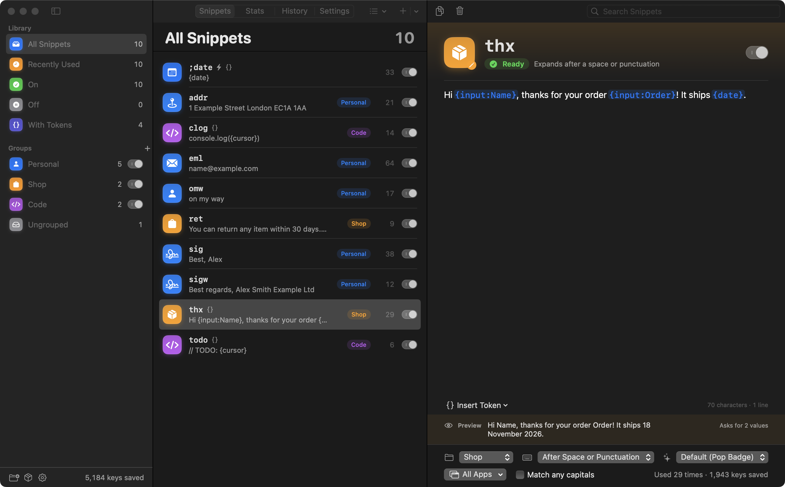
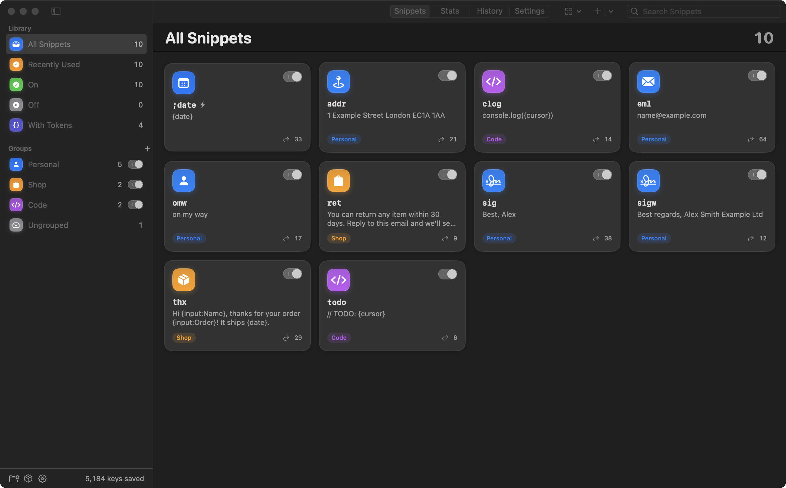
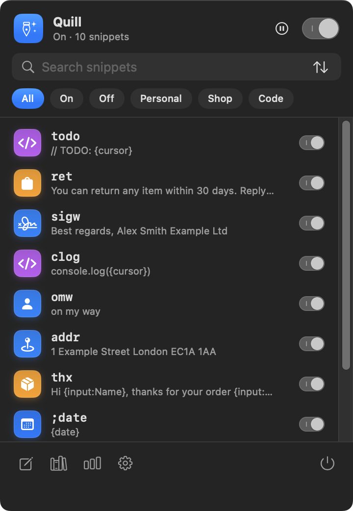
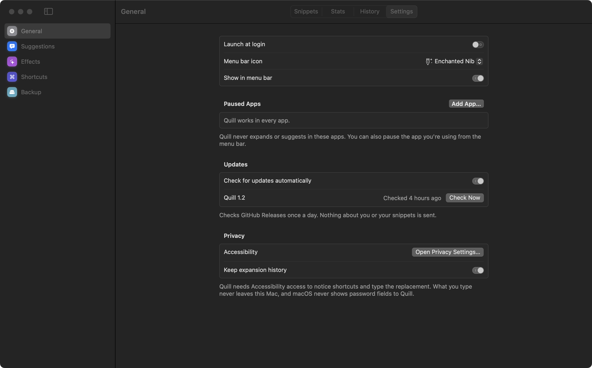
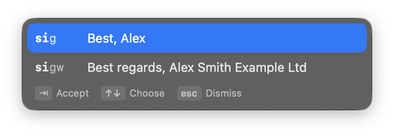
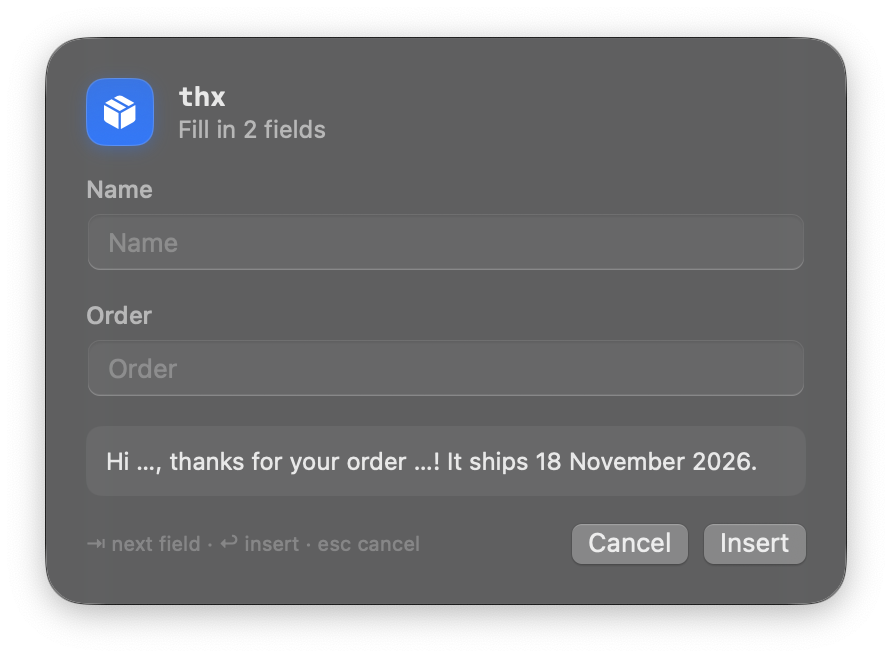
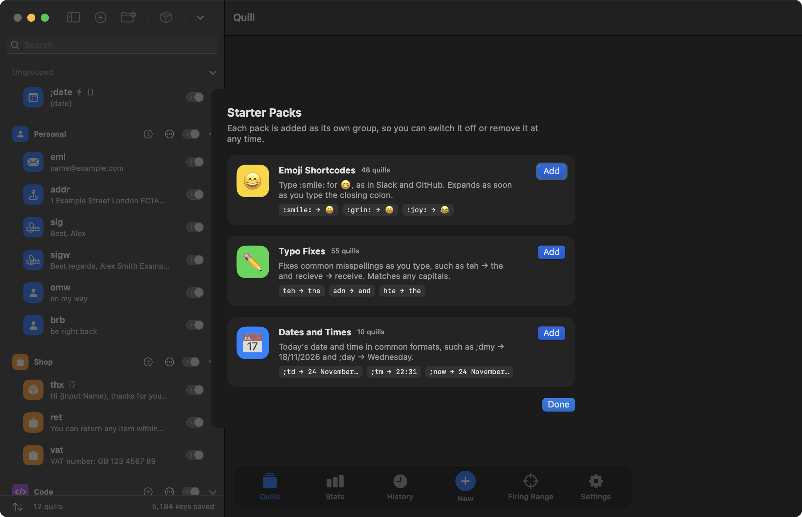
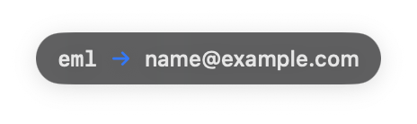

<div align="center">
  
  <h1>Quill</h1>
  <p><b>Type a short shortcut anywhere on your Mac and get the full text.</b></p>

[](https://github.com/ajd1776/Quill-Auto-Text-Replacement/releases/latest)


</div>

<p align="center">
  
</p>

Quill is a system-wide text expander that lives in the menu bar. You type `eml` and get `name@example.com`, in any app. It works like macOS Text Replacements, but works in every app, shows a suggestion bubble as you type, supports tokens and fill-in fields, and keeps everything in a local JSON file. Native SwiftUI, no dependencies, no account.

## Download

**[Download the latest version](https://github.com/ajd1776/Quill-Auto-Text-Replacement/releases/latest)**, open the `.dmg` and drag Quill into Applications.

Requires macOS 15 or later (Liquid Glass on macOS 26). Universal build for Apple Silicon and Intel.

> [!NOTE]
> Quill isn't notarised, so macOS blocks the first launch. Open System Settings › Privacy & Security, click **Open Anyway**, then allow Accessibility access when Quill asks. It needs that to see what you type and to type the replacement.

## Features

### Expansion
- **Works everywhere.** Native apps, browsers and Electron apps. Shortcuts are case-sensitive, whole-word matches.
- **Your choice of trigger.** Each snippet expands after a space, punctuation or Return, or the moment you finish typing the shortcut.
- **Undo.** Press Delete straight after an expansion to get back what you typed.
- **Case matching.** `EML` gives ALL CAPS and `Eml` gives Capitalised, if you turn it on for that snippet.
- **Per-app limits.** Make a snippet work only in the apps you choose, or pause Quill in an app entirely.

### Suggestions and tokens
- **Suggestion bubble.** A bubble appears above the text you're typing, like the macOS replacement bubble. Space accepts an exact match, Tab accepts the highlighted one, ↑ ↓ choose, Esc dismisses.
- **Tokens.** `{date}`, `{date:FORMAT}`, `{time}`, `{clipboard}`, `{cursor}` and `{input:Label}`.
- **Fill-in fields.** `{input:Name}` opens a small form before the text goes in.

### Library
- **Pages.** Toolbar tabs switch between Snippets, Stats, History and Settings (<kbd>⌘</kbd> <kbd>1</kbd>–<kbd>4</kbd>).
- **List or grid.** Browse snippets as rows or as cards, sorted by shortcut, most used, recently used or newest.
- **Smart filters.** All, Recently Used, On, Off and With Tokens, plus your own groups, each with a count.
- **Groups.** Colour (any custom colour), SF Symbol or emoji icon, and an on/off switch for the whole group. Drag snippets between groups, or drop text from another app to make a new snippet.
- **Command palette.** <kbd>⌘</kbd> <kbd>K</kbd> runs any action or jumps to any snippet.
- **Starter packs.** Emoji shortcodes (`:fire:` → 🔥), typo fixes (`teh` → `the`) and date formats (`;dmy` → `18/11/2026`). Each one installs as a group you can remove.

### Menu bar
- **Search panel.** Click the menu bar icon to search, filter by group, switch snippets on and off, or click a snippet to type it into the app you were using.
- **Quick controls.** Turn Quill on or off, pause for 15 minutes, an hour or until tomorrow, or pause in the current app.
- **10 menu bar icons.** Pick the one you like in Settings › General. Each shows a slash when Quill is off.

### Everything else
- **13 effects.** Typewriter, Pop Badge, Glow, Ink Underline, Fade, Slide, Bounce, Sparkle, Confetti, Ripple, Particle Cloud, Cyber, or none. Click-through overlays that respect Reduce Motion.
- **Stats and history.** Keys saved, expansions per day, top snippets, and a log of recent expansions. History stays on your Mac and can be turned off.
- **Shortcuts app.** Turn Quill On/Off, Get Snippet Text, Insert Snippet and Add Snippet actions.
- **Your data.** One local JSON file, daily backups (last 7), JSON import and export, and import from macOS Text Replacements.
- **Update check.** Checks GitHub Releases once a day and tells you when a new version is out.

## Screenshots

| Grid view | Menu bar panel |
| --- | --- |
|  |  |

| Stats | Settings |
| --- | --- |
|  |  |

| History | Command palette |
| --- | --- |
|  |  |

| Suggestion bubble | Fill-in form |
| --- | --- |
|  |  |

| Starter packs | Icon picker |
| --- | --- |
|  |  |

| Pop Badge effect | Cyber effect |
| --- | --- |
|  |  |

## How to use it

1. Open Quill and allow Accessibility access.
2. Click **+** in the toolbar, type a shortcut such as `eml` and the text it should become.
3. Type `eml` followed by a space in any app.

| Shortcut | Action |
| --- | --- |
| <kbd>⌘</kbd> <kbd>N</kbd> | New snippet |
| <kbd>⇧</kbd> <kbd>⌘</kbd> <kbd>N</kbd> | New group |
| <kbd>⌘</kbd> <kbd>K</kbd> | Command palette |
| <kbd>⌘</kbd> <kbd>1</kbd>–<kbd>4</kbd> | Snippets, Stats, History, Settings |
| <kbd>⇧</kbd> <kbd>⌘</kbd> <kbd>P</kbd> | Turn expansion on or off |
| <kbd>⌘</kbd> <kbd>,</kbd> | Settings |

The global on/off and search-panel hotkeys are set in Settings › Shortcuts.

## FAQ

<details>
<summary><b>Why does it need Accessibility access?</b></summary>

To see the shortcut you type (a keyboard event tap), to type the replacement, and to find the cursor so the bubble and effects sit above your text. What you type never leaves your Mac, and macOS never sends password fields to Quill.

</details>

<details>
<summary><b>Where are my snippets stored?</b></summary>

In `~/Library/Application Support/Quill/snippets.json`, with daily backups next to it. Settings › Backup can export and import it, and show the backups in Finder.

</details>

<details>
<summary><b>The bubble or effect appears in the wrong place in one app.</b></summary>

Quill asks the app where the cursor is. Some apps don't say; there the bubble is skipped rather than drawn in the wrong place. Expansion itself still works.

</details>

<details>
<summary><b>I rebuilt from source and expansion stopped working.</b></summary>

An ad-hoc signed build counts as a new app to macOS, so allow Accessibility access again. Signing with your own team (below) keeps the permission across rebuilds.

</details>

## Building from source

```bash
git clone https://github.com/ajd1776/Quill-Auto-Text-Replacement.git
```

```bash
cd Quill-Auto-Text-Replacement && Tools/install.sh
```

Builds a Release, copies it to `/Applications` and opens it. Needs Xcode 26. No Apple account is needed; without a Team ID the build is signed ad hoc. To keep the Accessibility grant across rebuilds, sign with your free Apple Development team:

```bash
echo 'DEVELOPMENT_TEAM = YOUR_TEAM_ID' > Config/Signing.xcconfig
```

<details>
<summary><b>Development notes</b></summary>

```bash
xcodebuild -project Quill.xcodeproj -scheme Quill -configuration Debug \
  -derivedDataPath build.noindex CODE_SIGN_IDENTITY=- build
```

```bash
build.noindex/Build/Products/Debug/Quill.app/Contents/MacOS/Quill -QuillSelfTest
```

Debug-only launch arguments:

- `-QuillSelfTest`: engine and model self-test.
- `-QuillDemoData`: in-memory sample library, never saved.
- `-QuillDemo <view>`: opens `library`, `grid`, `stats`, `history`, `editor`, `panel`, `palette`, a settings pane, `bubble`, `fillin`, or plays an effect by name.
- `-QuillUpdateCheck`: one live update check, then quits. `-QuillFakeUpdate` simulates an available update.

How it works:

- A session `CGEventTap` watches key-downs, keeps a short buffer and matches shortcuts at word boundaries.
- Replacement sends synthetic backspaces, then Unicode key events (paste with clipboard restore above 160 characters). Quill tags its own events and ignores them.
- The cursor position comes from the Accessibility API (`AXBoundsForRange`, or `AXBoundsForTextMarkerRange` for Chromium and Electron), queried off the main thread.

| Path | Contents |
| --- | --- |
| `Quill/App` | Entry point, app state, commands, menu bar icons, App Intents |
| `Quill/Engine` | Event tap, matching, key emitter |
| `Quill/Suggestions` | Suggestion bubble, fill-in form |
| `Quill/Overlays` | Cursor locator, effect overlays |
| `Quill/Model` | Snippets, groups, store, token renderer |
| `Quill/Views` | Pages, editor, menu bar panel, settings |
| `Quill/Search` | Floating search panel |
| `Quill/Hotkeys` | Global hotkeys and recorder |
| `Quill/Import` | macOS Text Replacements reader |
| `Quill/Debug` | Self-test and demo data |
| `Config` | `Base.xcconfig`, Info.plist additions |
| `Tools` | Install script, icon generators |

</details>

## Contributing

Bug reports and pull requests are welcome.
